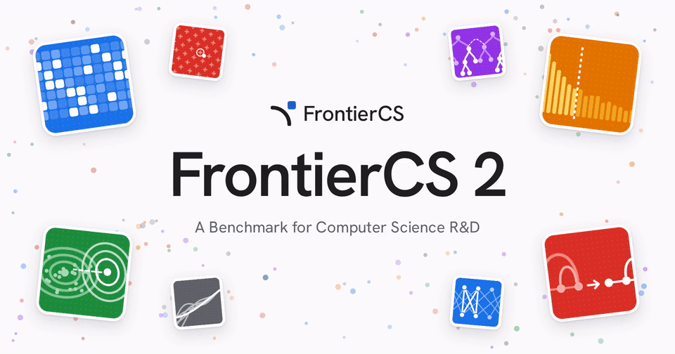
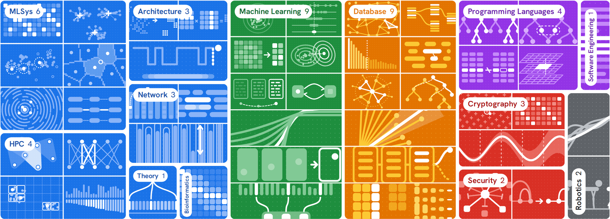
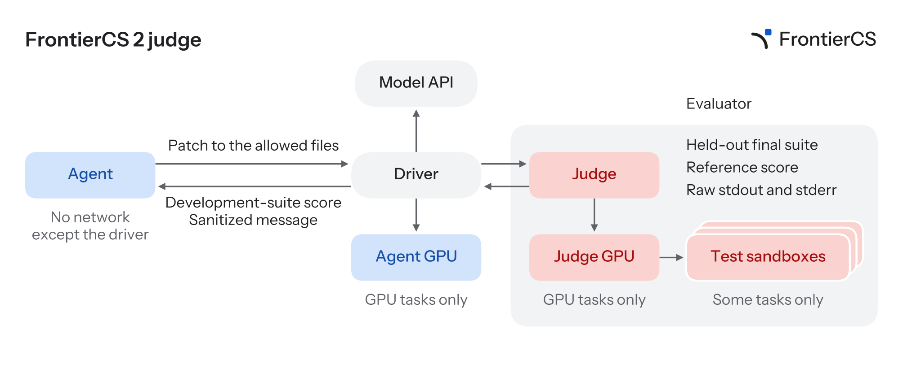

<p align="center">
  
</p>

<p align="center">
  <a href="https://arxiv.org/abs/2610.29932">Paper</a> ·
  <a href="https://frontier-cs.org">Website</a> ·
  <a href="https://www.kaggle.com/benchmarks/frontiercs/frontiercs-2">Kaggle</a> ·
  <a href="https://frontier-cs.org/blog/">Blog</a> ·
  <a href="TASKS.md">Tasks</a> ·
  <a href="https://huggingface.co/datasets/FrontierCS2/FrontierCS-2-runs">Runs</a> ·
  <a href="https://github.com/FrontierCS/Frontier-CS">FrontierCS 1.0</a> ·
  <a href="https://join.slack.com/t/frontiercs-org/shared_invite/zt-4dpo0sew2-c2FE0RPn2csApeDiXKKiEw">Slack</a> ·
  <a href="https://discord.gg/UhXzDTcey">Discord</a>
</p>

<p align="center">
  <a href="https://arxiv.org/abs/2610.29932"></a>
  <a href="TASKS.md"></a>
  <a href="TASKS.md"></a>
  <a href="https://www.kaggle.com/benchmarks/frontiercs/frontiercs-2"></a>
  <a href="https://huggingface.co/datasets/FrontierCS2/FrontierCS-2-runs"></a>
  <a href="https://join.slack.com/t/frontiercs-org/shared_invite/zt-4dpo0sew2-c2FE0RPn2csApeDiXKKiEw"></a>
  <a href="https://discord.gg/UhXzDTcey"></a>
</p>

FrontierCS 1.0 asked models to solve open-ended problems with continuous scores.
FrontierCS 2 asks whether an agent can push the research frontier beyond real,
published human work. Each task starts from a real research paper or artifact and
uses its published method as the reference to beat: the agent must read the
system, change a narrow part of it, measure, revise, and end up measurably better
than the human state of the art, within a fixed budget.

- **Repo-level.** Each task ships a real research artifact (a database engine, a
  compiler, a GPU kernel library, a training pipeline). The full repository gives
  context; a patch policy limits what the agent may edit.
- **Feedback-driven.** During its run the agent can submit candidates for
  *train* evaluation and read the task-approved metrics, without ever seeing the
  evaluator or the held-out workloads.
- **Hidden final evaluation.** The chosen answer is judged once, independently,
  on held-out workloads against the paper's own method as reference.
- **Paper-grounded.** Most tasks are built from a recent paper at venues such as
  VLDB, SIGMOD, NSDI, POPL, PLDI, PPoPP and SC.
- **Bounded and reproducible.** Every task pins its images by digest and declares
  its CPU, memory, GPU, time and evaluation budgets.

<p align="center">
  <picture>
    <source media="(prefers-color-scheme: dark)" srcset="docs/assets/task-mosaic-dark.png">
    
  </picture>
</p>

**48 / 150 tasks released**, more to come. Full list and resources: [TASKS.md](TASKS.md).

## How a task works

```text
tasks/frontier-cs-2.0-demo/problems/<Category>/<task_id>/
├── policy.json          # budgets and limits the platform enforces
├── upstream.lock.json   # hash of every file in the task (its source identity)
├── agent-base/          # Agent image: task statement, read-only repo, tools
├── agent-gpu/           # (GPU tasks) image for the Agent's GPU runners
├── datasets/            # train and eval workload descriptors
├── judge/               # evaluator, reference patch, beat specification
├── verifier/            # Verifier image that scores submissions
└── verifier-gpu/        # (GPU tasks) Verifier image for GPU scoring
tasks/metadata/<task_id>.yaml   # clean per-task summary, paper and resources
```

A run has three parts:

1. **Agent.** A Candidate (the model plus its harness, for example Codex) works in
   the Agent container for the task's answering time (five hours).
   It reads `/frontier/task/README.md`, edits a copy of the repository, and uses
   `frontier-submit` to send patches.
   GPU tasks give the Agent short-lived Modal GPU runners through `frontier-gpu`.
2. **Train feedback.** `frontier-submit train` scores a submission on the
   development workloads and returns the metrics the task allows. Each task caps
   the number of train calls.
3. **Final judging.** The answer saved with `frontier-submit store-final` or
   `frontier-submit final` is evaluated once on held-out workloads. The result is
   **PASS** only if the submission beats the reference on every workload and every
   metric in the task's beat specification. The continuous **score** measures
   progress beyond that.

<p align="center">
  
</p>

Each colored box is a sandbox. The Agent's sandbox reaches only the Driver: it sees a
development-suite score and a sanitized message per patch, and everything that decides
its result stays with the Judge.

Each task directory is immutable: its files hash to the source identity that tags
its published images, so the code in this repository is exactly what runs.
Corrections to descriptive metadata live in `tasks/metadata/`, outside the hashed
tree.

## What you need

| Account | Used for |
| --- | --- |
| **AWS** | The evaluation site: an EKS cluster, EFS storage, an in-cluster registry and the management service, created by Terraform in your account. |
| **Modal** | GPU tasks only: Agent GPU runners and GPU verification. CPU-only sites do not need it. |
| **API keys** | Model calls made by the Agent, and the task model of `progent_privilege_control`. Any OpenAI-compatible provider works (for example OpenRouter, which is the default allowed model domain). |

Tools on the operator machine: Terraform 1.15.x, AWS CLI v2, `kubectl` matching
the cluster version (1.34 in the example), Docker with BuildKit, Git, `curl` and
`tar`. Python and its dependencies are installed automatically by `./python`.
Task images are public on Docker Hub and pinned by digest; no registry login is
needed to install.

## Quickstart

1. **Configure the site.** Copy the example and set your AWS account ID, region,
   a globally unique Terraform state bucket and your operator IP (`/32`). The file
   holds no secrets.

   ```bash
   cp config/site.example.json config/site.json
   ```

   Keep `features.modal_gpu=false` for CPU tasks only, or set it to `true` for all
   tasks (see step 3).

2. **Check and plan.**

   ```bash
   ./python scripts/frontier_deploy.py validate  --config config/site.json
   ./python scripts/frontier_deploy.py preflight --config config/site.json
   ./python scripts/frontier_deploy.py plan      --config config/site.json
   ```

3. **Install.** Credentials come from your normal AWS credential chain. For GPU
   tasks, also export your Modal token:

   ```bash
   export MODAL_TOKEN_ID=...  MODAL_TOKEN_SECRET=...   # GPU sites only
   ./python scripts/frontier_deploy.py apply --config config/site.json \
     --confirm-account <your-account-id> --confirm-site <your-site-name>
   ./python scripts/frontier_deploy.py verify --config config/site.json
   ```

   `apply` creates the infrastructure, mirrors the pinned images, runs a scripted
   smoke evaluation and registers every selected task and the Codex Candidate.
   Keep `.state/<site>/`: it holds the kubeconfig and the receipts needed for
   later changes.

4. **Connect a model provider.** Open the Management UI and the model gateway
   through port-forwards (`<site>` is the site name in `site.json`):

   ```bash
   KUBECONFIG=.state/<site>/kubeconfig \
     kubectl -n frontier-system port-forward service/frontier-management 8080:8080
   KUBECONFIG=.state/<site>/kubeconfig \
     kubectl -n frontier-litellm port-forward service/frontier-litellm 4000:4000
   ```

   In the gateway UI at `http://127.0.0.1:4000/ui/`, add your model provider API
   keys under **Models → LLM Credentials** and add the models you want to evaluate.
   For the Codex Candidate's direct route, set these in the Candidate's private
   execution configuration:

   - `FRONTIER_MODEL_DIRECT_BASE_URL=<provider base URL>` (e.g. `https://openrouter.ai/api/v1`)
   - `FRONTIER_CODEX_MODEL=<provider model id>`
   - `CODEX_API_KEY=<your key>`

   Keys never go into this repository or `site.json`. The other harnesses we
   evaluated (Claude Code, Gemini via Pi, Kimi Code, Qwen Code and more) have
   build recipes in [`candidates/`](candidates) and are listed with their models
   in [`config/candidates.json`](config/candidates.json); see
   [Candidates](docs/candidates.md).

   `progent_privilege_control` also calls a model from inside the task (the
   agents it secures). Add a gateway model named `progent-agent-gpt-4o-mini` that
   routes to `openrouter/openai/gpt-4o-mini`, with a nonzero price (LiteLLM's
   built-in price for that model works), so the task's per-run key budgets are
   enforced. `features.task_model_aliases` in `site.json` lists the aliases your
   site serves; leave the alias out and the task is skipped.

## Run one task

Open `http://127.0.0.1:8080/`, choose a task and a Candidate, and start an
Evaluation. The run page shows the Agent's train submissions, the final verdict
(PASS/FAIL), the score and the downloadable evidence.

To replay a task's reference solution and confirm your site reproduces its
expected score:

```bash
./python scripts/reference_parity.py --task batch_local_counting \
  --config config/site.json --management-url http://127.0.0.1:8080 \
  --seed-receipt .state/<site>/task-seed-receipt.json \
  --receipt .state/<site>/reference-parity.json
```

## Tasks and resources

Every task gives the Agent five hours. The table below
summarizes the range; the per-task values are in [TASKS.md](TASKS.md) and
`tasks/metadata/`.

| | CPU-only tasks (32) | GPU tasks (16) |
| --- | --- | --- |
| Agent CPU / memory | 1–8 cores, 2–32 GiB | 3–8 cores, 4–32 GiB |
| Agent GPU | – | none, or 1× L4, A100-80GB or H100 for 0.25–15 GPU-hours |
| Verifier GPU | – | 1–8× L4, A100-80GB or H100, a budget of 0.5–364 GPU-hours |
| Train calls | 3–100 | 3–100 |
| Final evaluation timeout | 2 min – 3 h | 15 min – 30 h |

The Agent calls its model through its Candidate. One task also needs model keys
of its own: `progent_privilege_control` gets LiteLLM keys on the
`progent-agent-gpt-4o-mini` alias, $65 per run in total (agent exploration, train
and final), as described in the setup step above.

Regenerate the metadata and table after changing a task:

```bash
./python scripts/render_task_definition.py --all   # config/task-definitions.json
./python scripts/task_metadata.py write            # refresh derived fields
./python scripts/task_metadata.py table            # rewrite TASKS.md
```

## Released runs

The formal runs are on Hugging Face at
[FrontierCS2/FrontierCS-2-runs](https://huggingface.co/datasets/FrontierCS2/FrontierCS-2-runs): one run per task and model,
48 tasks × 13 models, each with its score, verdict,
final patch (when one was submitted) and full agent trace.

## Adding a task

A task is a directory in the layout shown in [How a task works](#how-a-task-works):
`policy.json`, the Agent and Verifier image sources, the judge with its
reference patch, and the workload descriptors. Add one only through the
importer, which validates the directory, builds and checks the task and
reference images, and updates the catalog and definitions:

```bash
./python scripts/import_task.py /path/to/<task_id> --plan
FRONTIER_IMAGE_NAMESPACE=<your-dockerhub-namespace> \
  ./python scripts/import_task.py /path/to/<task_id> --publish
```

Publishing needs push access to your Docker Hub namespace. See
[Add a task](docs/import-task.md).

## Development

```bash
make test       # unit tests (needs Git LFS objects: git lfs pull)
make validate   # task layouts and site configuration
./x check       # lint, formatting, tests and validation
```

Further reading: [architecture](docs/architecture.md),
[site configuration](docs/configuration.md),
[task selection](docs/task-selection.md),
[operations](docs/operations.md).

## Citation

If you use FrontierCS 2, please cite:

```bibtex
@misc{mang2026frontiercs2,
  title     = {{FrontierCS} 2: A Benchmark for Computer Science {R\&D}},
  author    = {Qiuyang Mang and Wenhao Chai and Runyuan He and Dongruixuan Li and Zihan Zheng and
               Yujun He and Xuanyi Zhou and Hao Wang and Siddhant Ray and Bo Peng and Ruyi Ji and
               Shuo Yang and Haocheng Xi and Boru Chen and Xinyang David Han and Melissa Pan and
               Mayank Mishra and Boxi Yu and Sijia Liu and Kerem Akillioglu and Yi Pan and
               Zirui Wang and Mert Cemri and Diogo Antunes and Yichuan Wang and
               Aiwei Ivy Zhang and Zhenyang Chen and Qizheng Zhang and Kaiyuan Liu and
               Wenyuan Huang and Sherry Ruan and Shu Liu and Dacheng Li and Zerui Cheng and
               Zeyu Shen and Shang Zhou and Hanfei Chen and Yuzhong Zhang and Bohan Lyu and
               Qu Ao and Han Zheng and Chonghe Jiang and Jingzhuo Hu and Xiaokun Chen and
               Kunjun Li and Zhiqing Zhong and Haoye Tian and Tong Zhao and Yunzhong He and
               Hanchen Li and Ofir Press and Jiantao Jiao and Kunle Olukotun and
               Karthik R. Narasimhan and Jingbo Shang and Koushik Sen and Matei Zaharia and
               Alex Dimakis and Ion Stoica and Joseph E. Gonzalez and Alvin Cheung},
  year      = {2026},
  eprint    = {2610.29932},
  archivePrefix = {arXiv},
  primaryClass  = {cs.LG},
  url       = {https://arxiv.org/abs/2610.29932}
}
```

and FrontierCS:

```bibtex
@inproceedings{mang2026frontiercs,
  title     = {{FrontierCS}: Evolving Challenges for Evolving Intelligence},
  author    = {Mang, Qiuyang and Chai, Wenhao and Li, Zhifei and others},
  booktitle = {Proceedings of the International Conference on Machine Learning},
  year      = {2026}
}
```

## License

FrontierCS 2 is released under [CC BY 4.0](LICENSE). Each task keeps the license
of the upstream artifact it is built from: the research code, models and datasets
inside a task directory, and anything its images download, stay under their own
licenses.

## Sponsors

<p align="center">
  <a href="https://modal.com"><picture><source media="(prefers-color-scheme: dark)" srcset="docs/assets/sponsors/modal-dark.svg"></picture></a>
&nbsp;&nbsp;&nbsp;&nbsp;
  <a href="https://www.laude.org"><picture><source media="(prefers-color-scheme: dark)" srcset="docs/assets/sponsors/laude-institute-dark.png"></picture></a>
&nbsp;&nbsp;&nbsp;&nbsp;
  <a href="https://scale.com"><picture><source media="(prefers-color-scheme: dark)" srcset="docs/assets/sponsors/scale-dark.svg"></picture></a>
&nbsp;&nbsp;&nbsp;&nbsp;
  <a href="https://www.kaggle.com"><picture><source media="(prefers-color-scheme: dark)" srcset="docs/assets/sponsors/kaggle-dark.svg"></picture></a>
</p>

We give special thanks to [Modal](https://modal.com) for its strong support of
this work, including the compute resources it sponsored. We also thank the
[Laude Institute](https://www.laude.org)'s Slingshot program and
[Scale AI](https://scale.com) for compute credits and community support, and
[Kaggle](https://www.kaggle.com) for sponsoring FrontierCS.
